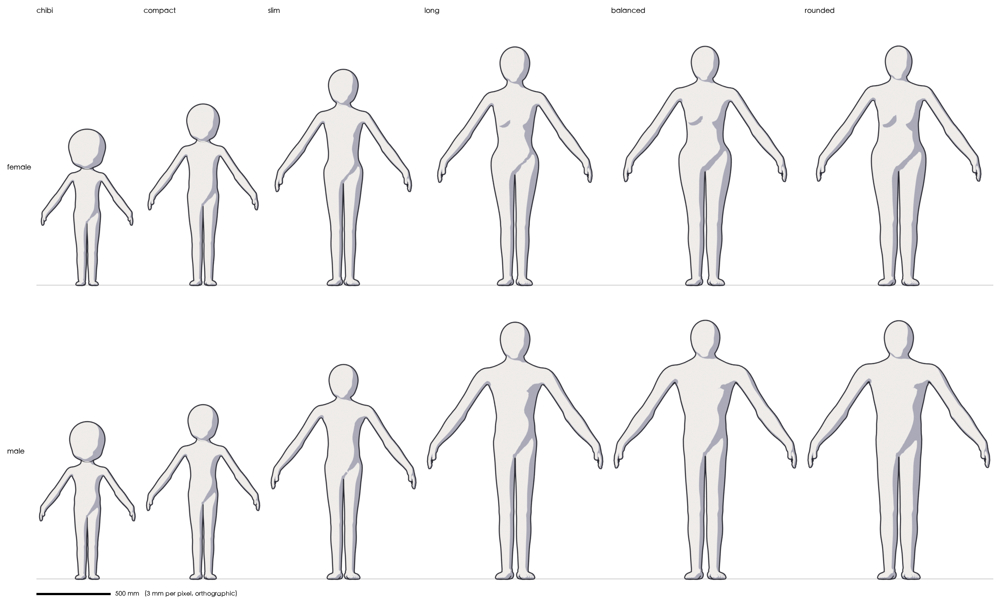

# sotaigen

[中文](README.zh.md)

A generator of anime-style human base bodies; the name is *sotai* (素体, a bare base body) plus *gen*. A
set of semantic measurements (stature, head height, shoulder, waist and hip breadths, limb lengths and
girths, and so on) goes in; a rigged, posable body comes out, ready to be finished in Blender as a
character's own.

> **Status: 0.1.0.** The [contracts](docs/en/reference/README.md) are frozen from this version: the
> topology and vertex order, the bones, the parameter file, the GLB's and the `.blend`'s metadata, the
> typical bodies' names, the head interface and the command line. A release that breaks one says so in
> the [CHANGELOG](CHANGELOG.md). The geometry itself improves from release to release.



*The twelve typical bodies, at one scale: each a parameter file, all one topology.*

## What it makes

- **One topology for every body.** The shape is an implicit field built from the parameters; a fixed
  template, cut from Blender Studio's CC0 Human Base Meshes, is wrapped onto it. Every body has the
  same 12676 vertices in the same order, the same UVs and the same 76 bones, so anything made for
  one body (a head, clothes, weight edits) carries over to the next.
- **A rigged `.blend`.** Control bones, constraints for the shoulder rhythm and twist sharing,
  corrective shapes driven by simple expressions, joint limits from sourced ranges of motion, and a
  subdivision modifier. It holds no Python, so it opens with auto-run off.
- **A GLB** with skin weights, corrective morph targets and placeholder features (eyes, mouth, ears,
  hair), for previews and tools that do not read `.blend`.
- **An editor in the browser** that turns sliders into a finished body within seconds of letting go,
  and reads and writes the parameter file.

VRM 1.0 export is planned, not done. This project checks delivery quality in Blender; downstream
projects handle game engine integration.

Not in scope: realistic bodies, clothing design, and the data of any particular character.

## Requirements

- Python 3.14, on macOS or Linux (not Windows).
- [Blender](https://www.blender.org/) 5.2 or later for the `.blend` and for renders; only 5.2.3 LTS has
  been run.
- From a checkout: [uv](https://docs.astral.sh/uv/) at the version in `pyproject.toml`; it finds or
  downloads the Python in `.python-version`. For Node, use [fnm](https://github.com/Schniz/fnm) with
  `.node-version`; pnpm is pinned by the root `package.json`. Setup is in [CONTRIBUTING](CONTRIBUTING.md).

## Getting started

From a checkout:

```sh
uv sync --all-extras
uv run sotaigen-dev build                 # every typical and test body into build/bodies/
uv run sotaigen-dev blend female-balanced
pnpm install && pnpm run editor
```

Blender is found through the `BLENDER` environment variable, then `blender` on `PATH`, then the macOS
app; an older one than 5.2 is refused.

Installed as a package, `sotaigen` makes bodies from a parameter file without a checkout:

```sh
pip install sotaigen                 # the GLB; add sotaigen-blender for the .blend
sotaigen check body.json
sotaigen glb body.json body.glb
sotaigen blend body.json body.blend  # needs Blender and sotaigen-blender
sotaigen swap-head body.blend head.blend out.blend
sotaigen scale body.json taller.json --stature 1650
```

They exit 0 when done, 1 when the body can't be made or written (a rule, a broken mesh), 2 for a wrong
command line or file, and 3 when Blender (5.2 or later) or sotaigen-blender is missing. The same from Python:

```python
import sotaigen

spec = sotaigen.read_spec("body.json")      # or sotaigen.typical("female-long")
body = sotaigen.generate(spec)
sotaigen.write_glb(body, "body.glb")
sotaigen.write_blend(body, "body.blend")
```

Solves and the experimental IPC contact tables (`sotaigen[contact]`) are cached in the user's cache
folder, or at `SOTAIGEN_CACHE`. So far it has only been run on Apple Silicon macOS; what else it can't do
yet is in the [known limitations](docs/en/reference/limitations.md).

## Documentation

For downstream projects, in English and Chinese:

- [docs/en/reference](docs/en/reference/README.md): the frozen contracts a downstream may rely on, how
  they change, a [glossary](docs/en/reference/glossary.md) and the
  [known limitations](docs/en/reference/limitations.md) ([中文](docs/reference/README.md)).
- [skills/sotaigen](skills/sotaigen/SKILL.md): how a downstream project makes a
  character's body with this tool, step by step; it doubles as an agent skill
  ([中文](skills/sotaigen/SKILL.zh.md)).

For contributors: [CONTRIBUTING.md](CONTRIBUTING.md) and [SECURITY.md](SECURITY.md). The working
documents are in Chinese:

- [docs/README.md](docs/README.md): an index by reader and task.
- [docs/ARCHITECTURE.md](docs/ARCHITECTURE.md): goals, pipeline, data contracts, invariants.
- [docs/DECISIONS.md](docs/DECISIONS.md): what is decided, and what is still open.

## License

- **Generated bodies** (`.blend`, GLB, and VRM to come) are yours, with no conditions from this
  project, commercial use included.
- **Code** is [Apache-2.0](LICENSE).
- **Code that imports Blender's Python API** (`bpy`, `bmesh`) is
  [GPL-3.0-or-later](LICENSES/GPL-3.0-or-later.txt), as Blender requires of published scripts. Each
  such file says so in its first line. The package `sotaigen` contains none of it: it is the separate
  package `sotaigen-blender` (`blender/`), which `sotaigen` runs inside Blender without importing.
- **Data** (`sotaigen/data/`: the typical and test bodies' specs, the template, the ranges of motion) is
  [CC0-1.0](LICENSES/CC0-1.0.txt).
- **Documentation** is Apache-2.0 too.
- The editor's UI components come from [shadcn/ui](https://ui.shadcn.com/), [MIT](LICENSES/MIT.txt).

[REUSE.toml](REUSE.toml) gives the license of every path.

## Acknowledgments

- The template is cut from [Human Base Meshes](https://studio.blender.org/) v1.4.1 by Blender
  Studio, CC0. How, and how to cut it again, is in [template/PROVENANCE.md](template/PROVENANCE.md).
- The motion clips used to check the rig were obtained from
  [mocap.cs.cmu.edu](http://mocap.cs.cmu.edu/). The database was created with funding from NSF
  EIA-0196217. See [motions/SOURCES.md](motions/SOURCES.md).
