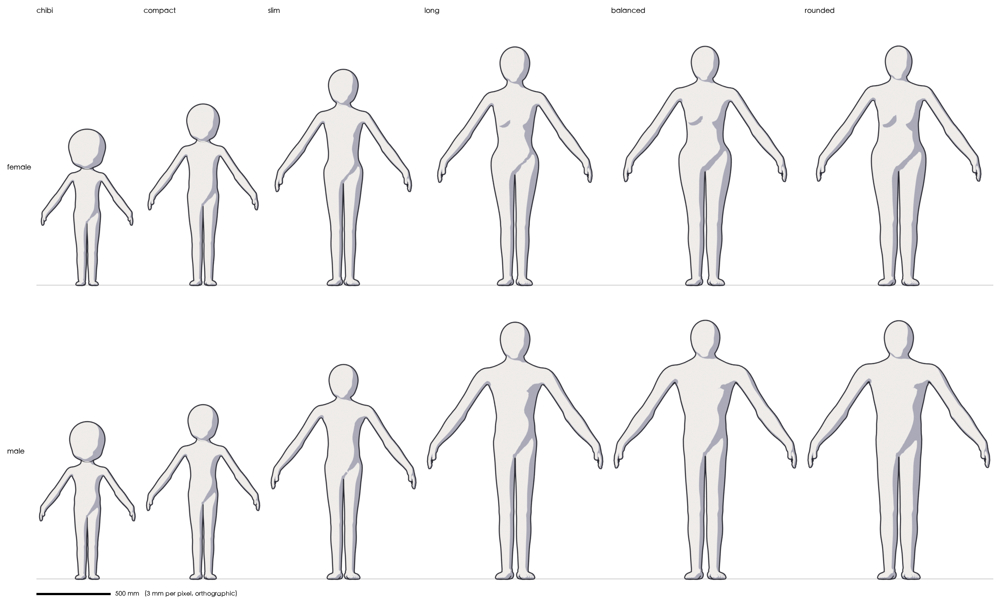

# sotaigen

[English](README.md)

动画风格的人体素体生成器，名字是“素体”（sotai）加 generator。输入一组有语义的实测量（身高、头高、肩宽、腰宽、胯宽、四肢的长度和围度等），输出绑定好、能摆姿势的身体，在 Blender 里接着做成角色自己的。

> **状态：0.1.0。** [对外约定](docs/reference/README.md)从这一版起冻结：拓扑和顶点顺序、骨骼、参数文件、GLB 和 `.blend` 的元数据、典型身体的名字、换头的接口、命令行。破坏约定的版本会写进 [CHANGELOG](CHANGELOG.md)。几何本身会随版本改进。



*十二个典型身体，同一比例尺：每个都是一份参数文件，都是同一套拓扑。*

## 做出什么

- **所有身体同一套拓扑。** 体形是由参数搭出的隐式场，固定的模板（从 Blender Studio 的 CC0 Human Base Meshes 切出）贴合上去。每个身体都是同样顺序的 12676 个顶点、同样的 UV 和同样的 76 根骨，所以给一个身体做的东西（头、衣物、改过的权重）能用到下一个身体上。
- **绑定好的 `.blend`：** 控制骨，肩胛节律和扭转分担用约束，修正形状由简单表达式驱动，关节极限来自有出处的活动范围，带细分曲面。文件里没有 Python，关掉自动运行脚本也能打开。
- **GLB：** 蒙皮权重、修正形状的变形目标、占位的五官（眼、嘴、耳、头发），给预览和不读 `.blend` 的工具用。
- **浏览器里的编辑器：** 松开滑块几秒内出完整的身体，能读写参数文件。

VRM 1.0 导出在计划中，还没做。本项目在 Blender 中检查交付质量，游戏引擎适配由下游完成。

不做的：写实人体、服装设计、任何具体角色的数据。

## 要求

- Python 3.14，macOS 或 Linux（不支持 Windows）。
- 写 `.blend` 和出图要 [Blender](https://www.blender.org/) 5.2 或更新的版本；只在 5.2.3 LTS 上跑过。
- 从检出目录用时要 [uv](https://docs.astral.sh/uv/)，版本见 `pyproject.toml`；它按 `.python-version` 找或下载 Python。Node 推荐用 [fnm](https://github.com/Schniz/fnm) 按 `.node-version` 管理，pnpm 版本见根目录 `package.json`。安装步骤见 [WORKFLOW](docs/WORKFLOW.md#1-开工)。

## 开始

从检出目录：

```sh
uv sync --all-extras
uv run sotaigen-dev build                 # 全部典型身体和测试身体，写到 build/bodies/
uv run sotaigen-dev blend female-balanced
pnpm install && pnpm run editor
```

Blender 的查找顺序是环境变量 `BLENDER`、`PATH` 里的 `blender`、macOS 的应用；低于 5.2 的会被拒绝。

装成包以后，`sotaigen` 不用检出目录就能从参数文件做身体：

```sh
pip install sotaigen                 # GLB；要 .blend 再装 sotaigen-blender
sotaigen check body.json
sotaigen glb body.json body.glb
sotaigen blend body.json body.blend  # 要 Blender 和 sotaigen-blender
sotaigen swap-head body.blend head.blend out.blend
sotaigen scale body.json taller.json --stature 1650
```

退出码：0 完成，1 身体做不成或写不出（规则不过、网格损坏），2 命令行或文件不对，3 缺 Blender（要 5.2 或更新）或 sotaigen-blender。Python 里一样：

```python
import sotaigen

spec = sotaigen.read_spec("body.json")      # 或 sotaigen.typical("female-long")
body = sotaigen.generate(spec)
sotaigen.write_glb(body, "body.glb")
sotaigen.write_blend(body, "body.blend")
```

求解结果和实验特性 IPC 接触表（`sotaigen[contact]`）缓存在用户缓存目录，`SOTAIGEN_CACHE` 可以改。到目前只在 Apple Silicon 的 macOS 上跑过；别的还不行的地方见[已知限制](docs/reference/limitations.md)。

## 文档

给下游的，中英两版：

- [docs/reference](docs/reference/README.md)：下游能依赖的冻结约定、它们怎样变、[术语表](docs/reference/glossary.md)和[已知限制](docs/reference/limitations.md)（[English](docs/en/reference/README.md)，英文是规范文本）。
- [skills/sotaigen](skills/sotaigen/SKILL.zh.md)：下游怎样用本工具一步步做出角色的身体，英文版同时是代理的技能（[English](skills/sotaigen/SKILL.md)）。

给贡献者的：[CONTRIBUTING.md](CONTRIBUTING.md) 和 [SECURITY.md](SECURITY.md)（英文）。内部工作文档是中文：

- [docs/README.md](docs/README.md)：按读者和要做的事索引。
- [docs/ARCHITECTURE.md](docs/ARCHITECTURE.md)：目标、流水线、数据约定、不变量。
- [docs/DECISIONS.md](docs/DECISIONS.md)：已定的决定和还没定的问题。

## 许可

- **生成的身体**（`.blend`、GLB，以后的 VRM）归你，本项目不加任何条件，包括商用。
- **代码** 是 [Apache-2.0](LICENSE)。
- **用到 Blender Python 接口的代码**（`bpy`、`bmesh`）是 [GPL-3.0-or-later](LICENSES/GPL-3.0-or-later.txt)，这是 Blender 对发布的脚本的要求，每个这样的文件第一行都写明了。`sotaigen` 包里没有这类代码：它们是另一个包 `sotaigen-blender`（`blender/`），`sotaigen` 不导入它，而是在 Blender 里运行它。
- **数据**（`sotaigen/data/`：典型身体和测试身体的参数、模板、活动范围）是 [CC0-1.0](LICENSES/CC0-1.0.txt)。
- **文档** 也是 Apache-2.0。
- 编辑器的界面组件来自 [shadcn/ui](https://ui.shadcn.com/)，[MIT](LICENSES/MIT.txt)。

[REUSE.toml](REUSE.toml) 给出每个路径的许可。

## 致谢

- 模板切自 Blender Studio 的 [Human Base Meshes](https://studio.blender.org/) v1.4.1，CC0。怎么切、怎样重新切，见 [template/PROVENANCE.md](template/PROVENANCE.md)。
- 检查绑定用的动作片段取自 [mocap.cs.cmu.edu](http://mocap.cs.cmu.edu/)，该数据库由 NSF EIA-0196217 资助，见 [motions/SOURCES.md](motions/SOURCES.md)。
